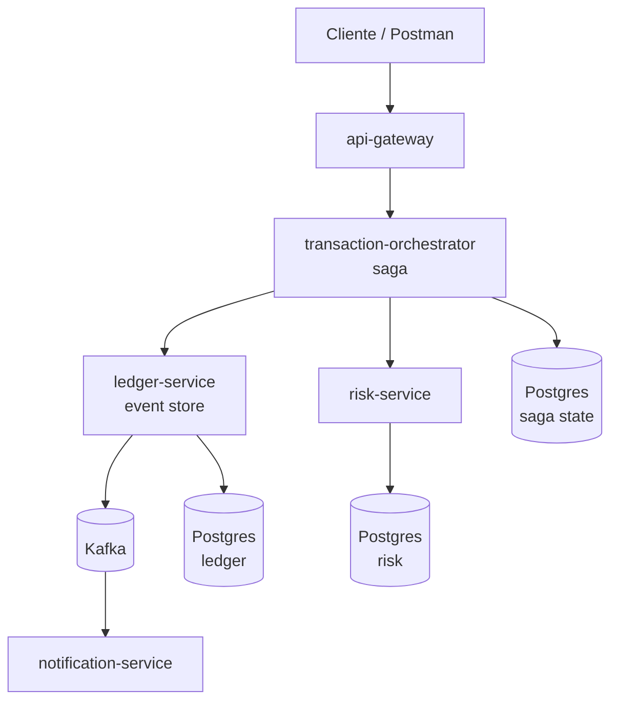
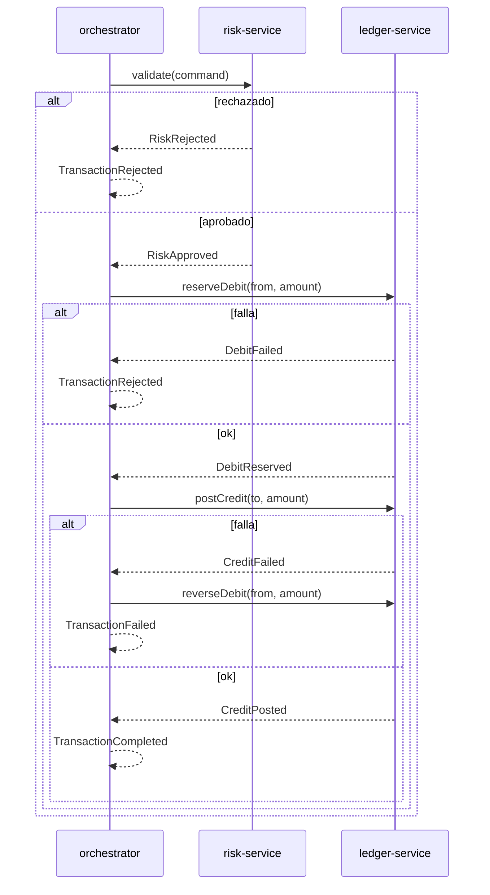

# Plan de Portafolio: Ledger Transaccional Fintech (Microservicios)

Sep 22, 2026 · @Someone

## Objetivo

Demostrar en portafolio el dominio de arquitectura event-driven con microservicios, aplicado a un caso fintech (procesamiento de transacciones con ledger de doble entrada), para postular a roles de backend/fintech sin experiencia laboral previa en el sector.

Diferenciador frente a un CRUD típico: contabilidad de doble entrada inmutable, saga con compensación, idempotencia, outbox pattern y event sourcing — temas que se preguntan en entrevistas técnicas de fintech.

## Arquitectura



Comunicación síncrona (REST) entre orquestador y servicios para los pasos de la saga; Kafka para eventos de dominio (auditoría, notificaciones, futuros consumidores). Cada servicio es dueño exclusivo de su base de datos (database-per-service).

## Servicios

| Servicio | Responsabilidad | Arquitectura interna |
| --- | --- | --- |
| api-gateway | Entrada única, routing, auth, rate limiting | Spring Cloud Gateway |
| transaction-orchestrator | Coordina la saga, máquina de estados de la transacción | Hexagonal + MVC |
| ledger-service | Dueño exclusivo del ledger (event store + balance) | Hexagonal + MVC |
| risk-service | Valida límites y blacklist antes de comprometer la transacción | Hexagonal + MVC |
| notification-service | Consumidor pasivo de eventos completados/fallidos | MVC simple |

## Stack tecnológico

| Componente | Tecnología |
| --- | --- |
| Lenguaje / runtime | Java 21 + Spring Boot 3 |
| Build | Gradle (multi-módulo) |
| Web | Spring Web MVC |
| Persistencia | Spring Data JPA + PostgreSQL (una BD por servicio) |
| Migraciones | Liquibase (changelogs YAML) |
| Mensajería | Kafka + Schema Registry (Avro o JSON Schema) |
| Resiliencia | Resilience4j (circuit breaker, retry) |
| Gateway | Spring Cloud Gateway |
| Testing | JUnit 5, Mockito, Testcontainers (Postgres + Kafka), ArchUnit |
| Observabilidad | Spring Boot Actuator, Micrometer + Prometheus, logs con correlationId |
| Orquestación local | Docker Compose |
| Documentación API | springdoc-openapi (Swagger) |

## Patrones a implementar

- **Ledger de doble entrada (append-only)**: cada movimiento es débito + crédito balanceado; el balance es una proyección, nunca se actualiza directo.
- **Event Sourcing**: el log de eventos del ledger es la fuente de verdad; el balance se reconstruye por replay.
- **Saga orquestada** con compensación: reversas como nuevas entries, nunca borrado.
- **Idempotencia**: idempotency key por request + tabla de deduplicación en cada servicio.
- **Outbox pattern**: escritura a Postgres y publicación a Kafka sin dual-write.
- **CQRS (opcional)**: balance como read model separado del event store, con Redis como cache.
- **Optimistic locking**: control de concurrencia sobre el estado de cuenta.
- **Reconciliación**: job batch que verifica suma(débitos) = suma(créditos).

## Flujo de la saga (transferencia)



Estado de la saga persistido en `transaction-orchestrator` (tabla propia) para poder recuperar y continuar/compensar si el orquestador cae a mitad de flujo.

## Roadmap de construcción

1. `ledger-service` — dominio (Account, LedgerEntry, Money), hexagonal, Postgres, Liquibase, tests unitarios del dominio.
2. `risk-service` — reglas simples de validación (límites, blacklist).
3. `transaction-orchestrator` — máquina de estados de la saga, llamadas REST a risk y ledger, persistencia del estado.
4. Idempotencia + outbox en `ledger-service` y `transaction-orchestrator`.
5. `notification-service` — consumidor Kafka de eventos completados/fallidos.
6. `api-gateway` — routing hacia orchestrator.
7. Observabilidad (Actuator, Micrometer, correlationId) y Testcontainers de integración.
8. Documentación (README con diagrama, decisiones de arquitectura) y demo en Postman/Swagger.

## Estructura de repositorio

Dos repositorios públicos separados:

- `atlas-bank-services`: mono-repo Gradle con todos los microservicios (evita el overhead de multi-repo entre servicios; queda claro para quien lo revisa en GitHub).
- `atlas-bank-client`: cliente (stack por definir).

```
atlas-bank-services/
├── api-gateway/
├── transaction-orchestrator/
├── ledger-service/
├── risk-service/
├── notification-service/
├── docs/
├── docker-compose.yml
├── settings.gradle.kts
└── build.gradle.kts
```

Las bases ya están creadas (build multi-módulo, Liquibase por servicio, dominio inicial del ledger con tests, Docker Compose). Ver el README del repo para ejecutar.

Siguiente paso: `ledger-service` (paso 1 del roadmap) — capas `application` e `infrastructure` sobre el dominio ya existente (`Money`, `LedgerEntry`, `Journal`, `Account`), sin Spring ni JPA en el paquete `domain`.
